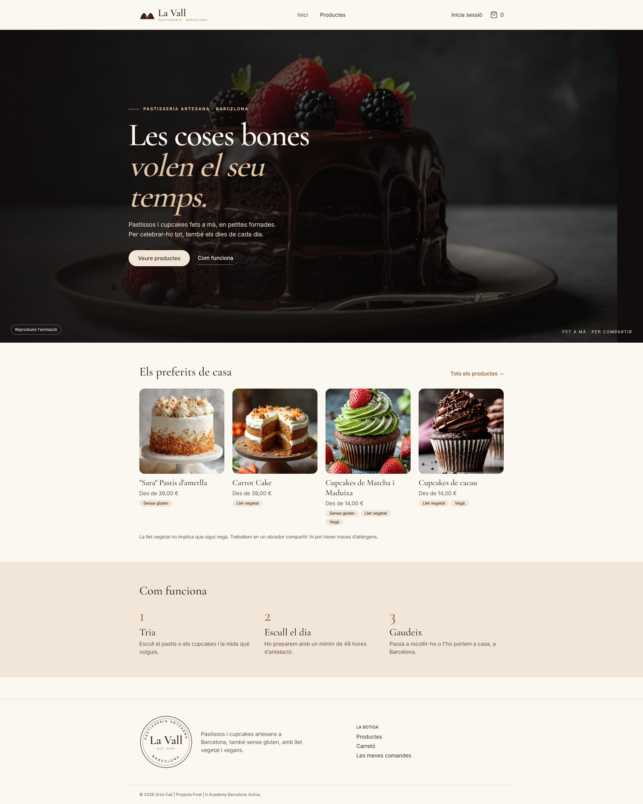
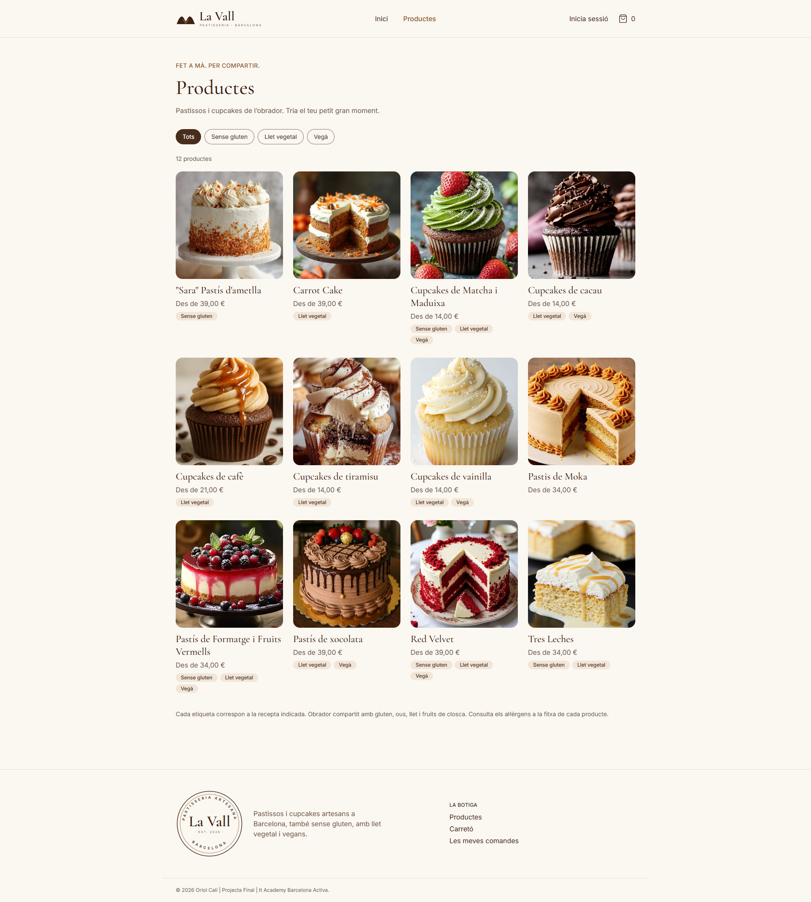
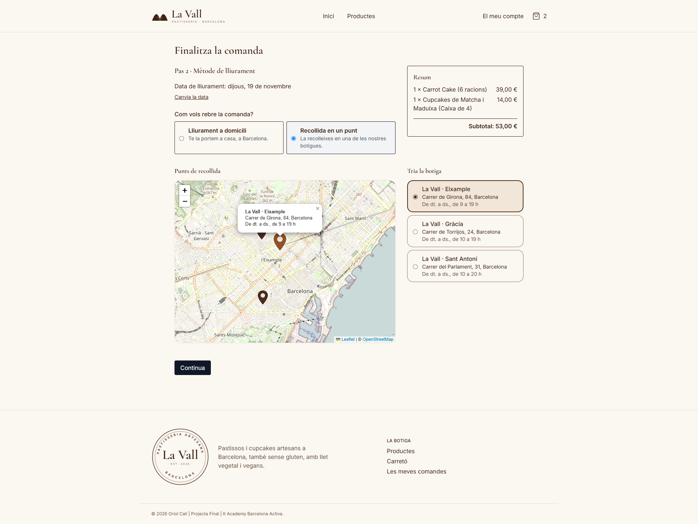
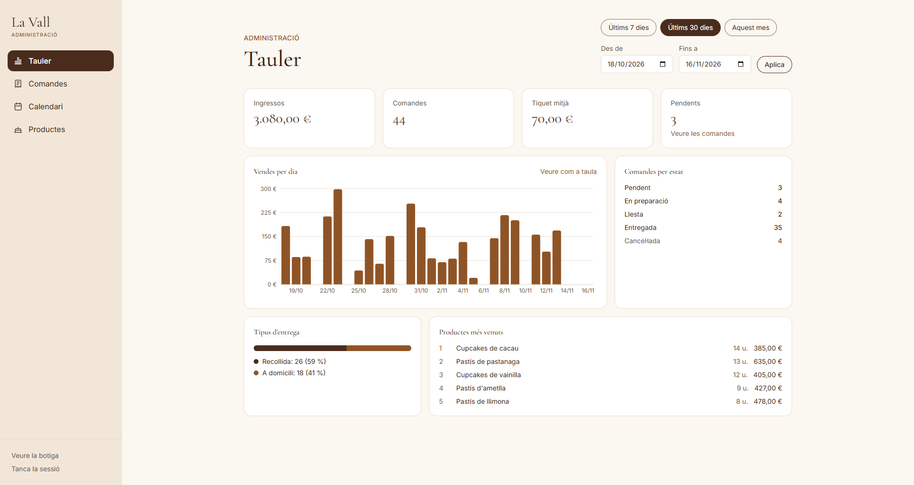

# Pastisseria La Vall

Online shop for an artisan bakery in Barcelona. Customers can browse the catalogue of cakes and cupcakes (with gluten-free, plant-milk and vegan options), choose the day and the way to receive their order, and follow its status. The bakery manages products, orders and the delivery calendar from an admin dashboard with statistics.

Final project of the IT Academy web development course.

**Live demo:** https://pastisseria-la-vall.vercel.app

> The backend runs on Render's free plan and sleeps after 15 minutes without traffic. The first request can take about 45 seconds.

The interface of the shop is in Catalan.

## Screenshots

| Home | Catalogue |
| --- | --- |
|  |  |

| Checkout with pickup points | Admin dashboard |
| --- | --- |
|  |  |

## Goals

- Let a small bakery sell online without depending on an external platform.
- Respect the capacity of the kitchen: a maximum number of orders per day, 48 hours of preparation, and no deliveries on Sundays or holidays.
- Give the bakery a quick view of sales and of the deliveries of each day.
- Build an accessible website that works well on mobile.

## Tech stack

| Area | Technologies |
| --- | --- |
| Frontend | React 19, TypeScript, Vite 8, React Router 7, Tailwind CSS 4, Recharts, FullCalendar, Leaflet |
| Backend | Node.js 24, Express 5, TypeScript, Prisma 7 |
| Database | PostgreSQL on Neon |
| Authentication | Firebase Authentication (email and password) and Firebase Admin on the backend |
| Images | Cloudinary (signed uploads from the backend) |
| Testing | Vitest, Testing Library and `@vitest/coverage-v8` |
| Code quality | ESLint, Prettier and GitHub Actions |
| Deployment | Vercel (frontend) and Render (backend) |

## Features

**Shop**
- Full-screen home page with a slowly moving cake photo (CSS animation) that can be paused and stays still when the user prefers reduced motion.
- Catalogue with dietary filters, and a product page with sizes, allergens and prices.
- Cart saved in the browser and checked against the backend before ordering.
- Three-step checkout: delivery date (calendar with the available days), home delivery in Barcelona or pickup at a shop (map), and review.
- Orders with a unique number, protection against double submissions, and stock and daily capacity checks.
- Customer account with the order history and the status of each order.

**Admin**
- Dashboard with revenue, number of orders, average order value, sales per day, orders by status and by delivery method, and best-selling products, with a date filter.
- Order management: list filtered by status, order detail and status changes (pending → preparing → ready → delivered, or cancelled).
- Delivery calendar with month, week, day and list views, filters, and status changes from the calendar itself.
- Product management: create, edit, activate or deactivate products and sizes, upload the photo to Cloudinary, and search and filter by category and status.

**Security and quality**
- Admin routes protected on the frontend and on the backend, and validation of every input.
- CORS limited to the configured origins, rate limits on authentication and on order creation, and errors always returned as `{ error }`.
- Pages loaded with `React.lazy`: shop visitors never download the admin code.

## Requirements

- Node.js 24
- pnpm 12
- A Firebase project with Authentication (email and password)
- A PostgreSQL database (for example, on Neon)
- A Cloudinary account, to upload product photos

## Installation

```bash
git clone https://github.com/oriolcalicab/pastisseria-la-vall.git
cd pastisseria-la-vall
```

The frontend and the backend are separate projects, each with its own `package.json`:

```bash
cd backend
pnpm install
cd ../frontend
pnpm install
```

## Environment variables

Copy each `.env.example` file to `.env` and fill it in. **The `.env` files are never committed to the repository.**

**`backend/.env`**

| Variable | Purpose |
| --- | --- |
| `PORT` | Server port (3000 by default) |
| `DATABASE_URL` | PostgreSQL connection string |
| `FIREBASE_PROJECT_ID` | Firebase project |
| `FIREBASE_CLIENT_EMAIL` | Firebase Admin service account |
| `FIREBASE_PRIVATE_KEY` | Private key of the service account |
| `CORS_ORIGINS` | Origins allowed to use the API, separated by commas (only `http://localhost:5173` when it is not set) |
| `CLOUDINARY_CLOUD_NAME` | Cloudinary cloud name |
| `CLOUDINARY_API_KEY` | Cloudinary API key |
| `CLOUDINARY_API_SECRET` | Cloudinary secret (only used by the backend) |

**`frontend/.env`**

| Variable | Purpose |
| --- | --- |
| `VITE_API_URL` | Backend URL |
| `VITE_FIREBASE_API_KEY` | Firebase web configuration |
| `VITE_FIREBASE_AUTH_DOMAIN` | Firebase web configuration |
| `VITE_FIREBASE_PROJECT_ID` | Firebase web configuration |
| `VITE_FIREBASE_STORAGE_BUCKET` | Firebase web configuration |
| `VITE_FIREBASE_MESSAGING_SENDER_ID` | Firebase web configuration |
| `VITE_FIREBASE_APP_ID` | Firebase web configuration |

## Service setup

**Firebase**
1. Create a project in the Firebase console and enable **Authentication → Email/Password**.
2. In **Project settings → Your apps**, add a web app and copy its configuration to the `VITE_FIREBASE_*` variables.
3. In **Service accounts**, generate a private key and copy `project_id`, `client_email` and `private_key` to the backend `FIREBASE_*` variables.

**PostgreSQL and Prisma**
1. Create a PostgreSQL database and put its connection string in `DATABASE_URL`.
2. Create the tables and generate the Prisma client:
   ```bash
   cd backend
   pnpm exec prisma migrate deploy
   pnpm exec prisma generate
   ```
3. Load the initial data (categories, products, pickup points, settings and holidays):
   ```bash
   pnpm exec prisma db seed
   ```
4. Optional: create 55 demo orders to see the dashboard and the calendar with data (stock is not changed):
   ```bash
   pnpm seed:demo
   ```
   To remove them: `pnpm seed:demo:remove`.

**Cloudinary**
1. Create a free Cloudinary account.
2. From the dashboard, copy the **Cloud name**, the **API Key** and the **API Secret** to the backend `CLOUDINARY_*` variables.
3. Product photos are stored in the `pastisseria-la-vall/products` folder, which is created automatically on the first upload.

## Running locally

In two terminals:

```bash
cd backend
pnpm dev
```

```bash
cd frontend
pnpm dev
```

- Frontend: http://localhost:5173
- Backend: http://localhost:3000 (health check: `/health`)

## Admin access

There are no users or passwords in the repository. To access the admin area:

1. Sign up on the website with your email.
2. Give yourself the admin role from the backend:
   ```bash
   cd backend
   pnpm set-role your-email@example.com admin
   ```
3. Sign in again: you will go straight to `/admin`.

## Testing and quality

```bash
pnpm test             # unit and integration tests
pnpm test:coverage    # with the coverage report (20 % minimum)
pnpm lint
pnpm exec prettier --check .
pnpm build
```

The backend also has tests against a separate test database (`backend/.env.test`):

```bash
cd backend
pnpm test:db
```

| | Tests | Statements | Branches | Functions | Lines |
| --- | --- | --- | --- | --- | --- |
| Backend | 396 | 94.39 % | 93.28 % | 97.23 % | 94.39 % |
| Frontend | 468 | 91.04 % | 84.86 % | 89.32 % | 92.75 % |

On every pull request, GitHub Actions checks the formatting, the lint, the tests with coverage and the build of the backend and the frontend, and runs the database tests against a temporary PostgreSQL.

## Project structure

```
pastisseria-la-vall/
├── backend/
│   ├── prisma/              # schema, migrations and seed data
│   ├── scripts/             # set-role and demo orders
│   └── src/
│       ├── app.ts           # Express app (CORS, routes and errors)
│       ├── index.ts         # server start
│       ├── config/          # environment, Firebase and CORS
│       ├── middleware/      # authentication, admin, errors and rate limits
│       ├── routes/          # API endpoints
│       ├── services/        # data access with Prisma
│       ├── validation/      # request validation
│       ├── utils/           # pure functions (dates, statuses, signatures…)
│       └── types/
├── frontend/
│   └── src/
│       ├── components/      # header, footer, layouts and shared pieces
│       ├── features/        # one folder per area: admin, auth, cart, catalog,
│       │                    # checkout, delivery, home, orders and pickup
│       │                    # (each with components, hooks, services, types and utils)
│       ├── pages/           # pages only put together the pieces of the features
│       ├── lib/             # general helpers (prices, dates, API)
│       ├── styles/          # theme, components, map and calendar styles
│       ├── router.tsx
│       └── lazyPages.ts     # pages loaded when they are opened
├── docs/
│   ├── gherkin/             # behaviour scenarios (Given / When / Then)
│   ├── screenshots/
│   └── design.md
└── .github/workflows/ci.yml
```

## API

| Method | Route | Access |
| --- | --- | --- |
| POST | `/api/auth/register` | Firebase user |
| GET | `/api/auth/me` | Registered user |
| GET | `/api/categories` | Public |
| GET | `/api/products`, `/api/products/:id` | Public |
| POST | `/api/cart/validate` | Public |
| GET | `/api/delivery-dates` | Public |
| GET | `/api/pickup-points` | Public |
| GET | `/api/checkout/shipping-fee` | Public |
| POST, GET | `/api/orders`, `/api/orders/:id` | Customer |
| GET, POST, PUT, PATCH | `/api/admin/products…` | Admin |
| GET, PATCH | `/api/admin/orders…`, `/api/admin/orders/calendar` | Admin |
| GET | `/api/admin/stats?from&to` | Admin |
| POST | `/api/admin/uploads/signature` | Admin |

## Documentation

- Behaviour scenarios: [`docs/gherkin`](docs/gherkin)
- Design guide: [`docs/design.md`](docs/design.md)
- Technical documentation (sitemap, user flows, diagrams and technical report): [`docs/`](docs)
- Figma design: https://www.figma.com/design/CBgllu3iKbRGdcfgLQ7qPE
- Planning on Trello: "Projecta Final" board

## Author

Oriol Calí | 2026. 
