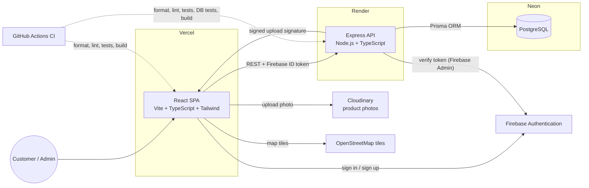
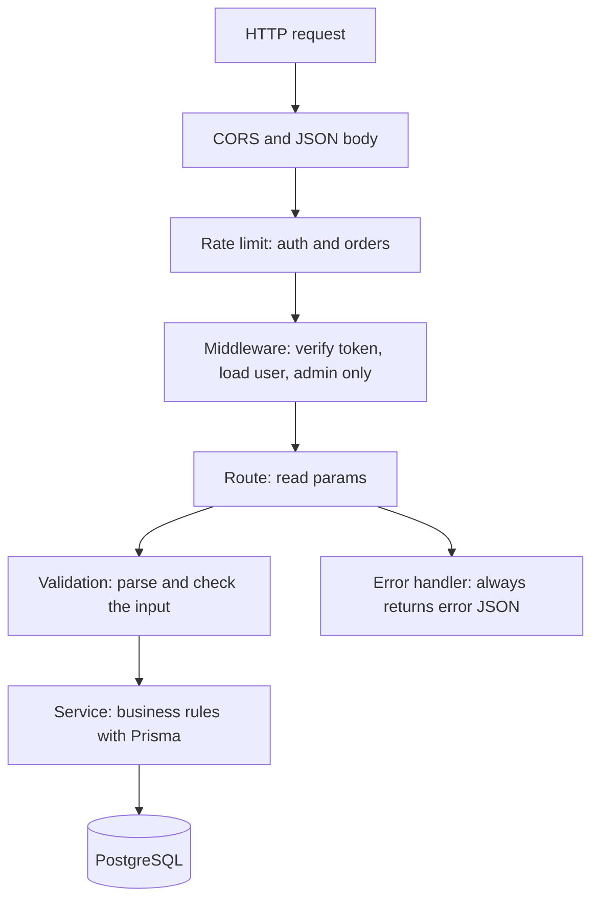

# Architecture

## How a request works

1. The user signs in with Firebase in the browser. Firebase returns an **ID token**.
2. Each request to the API sends the token in the `Authorization: Bearer` header.
3. The backend checks the token with Firebase Admin, finds the user in the database and checks the role (`customer` or `admin`).
4. The route validates the input, the service uses Prisma to read or write PostgreSQL, and the answer goes back as JSON.

## Layers of the backend

## Frontend organisation

- `pages/` only put together the pieces of each feature.
- `features/<area>/` contain `components`, `hooks`, `services` (API calls), `types`, `utils` and `data`.
- Shared state uses React Context: authentication (`AuthContext`), cart (`CartContext`) and the admin dashboard (`DashboardContext`).
- Every page except the home page is loaded with `React.lazy`, so the shop never downloads the admin code.

## Deployment

- `develop` is the working branch; every change arrives through a pull request with CI.
- Publishing is a pull request from `develop` to `main`. Vercel and Render deploy `main` automatically.
