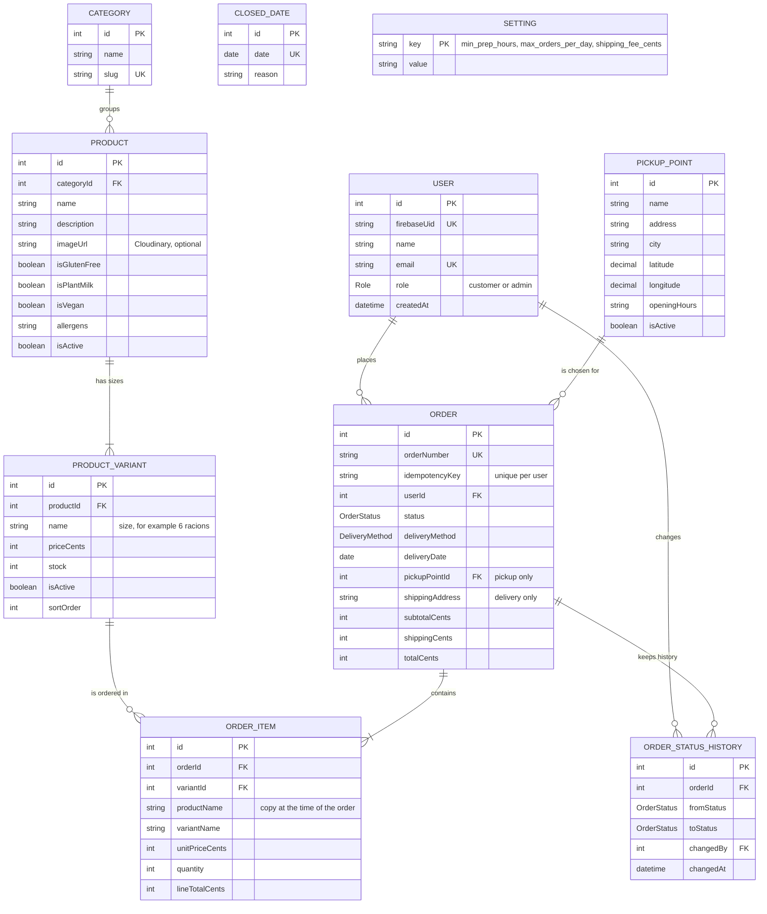

# Data model

PostgreSQL database managed with Prisma. The schema is in [`backend/prisma/schema.prisma`](../backend/prisma/schema.prisma).

## Notes

- **Money in cents** (`priceCents`, `totalCents`…) as integers: no rounding errors.
- **Order items copy** the product name, size and price, so an old order does not change when a product is edited.
- **`(userId, idempotencyKey)` is unique**: the same checkout sent twice creates only one order.
- **Indexes** on `(deliveryDate, status)` for the calendar and the daily capacity, and on `(categoryId, isActive)` for the catalogue.
- **Settings** and **closed dates** are tables, so the bakery rules can change without a new deploy.
