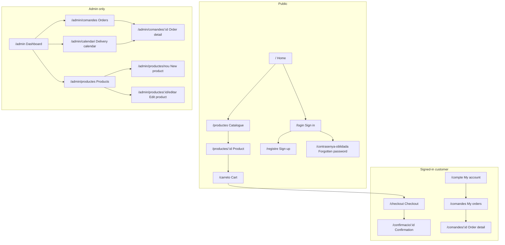

# Sitemap

- Customer pages are protected by `ProtectedRoute`: a visitor is sent to `/login` and comes back after signing in.
- Admin pages are protected by `AdminRoute` on the frontend and by the `adminOnly` middleware on the backend.
- Any other address shows the "page not found" page inside the shop layout.
